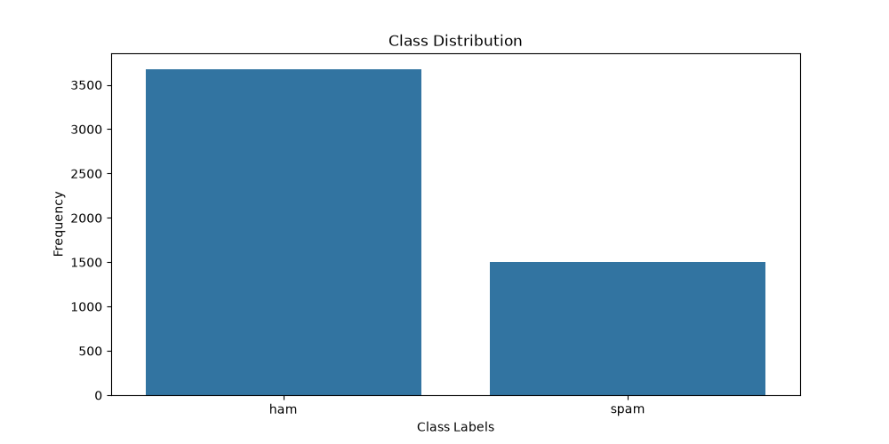

<div align="center">

# 📧 Email Spam Detection

**Classifying emails as spam or ham with classic machine learning, benchmarked against a pretrained Hugging Face transformer.**


</div>

---

## 📌 Overview

Spam filters protect inboxes from unwanted and malicious mail. This project builds a spam classifier on the Enron-style email corpus, then compares three scikit-learn models and one pretrained Hugging Face model to see which approach works best.

**Highlights**

- 🔍 Exploratory analysis: class balance, word frequencies, text-length statistics
- 🧹 Text preprocessing: lowercasing, punctuation and stop-word removal
- 🤖 Three trained models: KNN, Naive Bayes, Logistic Regression
- 🧪 Benchmark against a pretrained Hugging Face BERT-tiny model

---

## 📊 Dataset

| Property | Value |
|---|---|
| File | `spam_ham_dataset.csv` |
| Total emails | 5,171 |
| Ham (not spam) | 3,672 (71%) |
| Spam | 1,499 (29%) |
| Columns | `Unnamed: 0`, `label`, `text`, `label_num` |

The classes are imbalanced, and spam emails run slightly longer on average (about 1,223 characters vs about 977 for ham).

<div align="center">



</div>

---

## ⚙️ Pipeline

```
Raw email text
      │
      ▼
Preprocessing  →  lowercase · strip punctuation · remove stop words
      │
      ▼
Vectorization  →  CountVectorizer (50,179 features)
      │
      ▼
Train/Test split  →  80% / 20%  (random_state=42)
      │
      ▼
Models  →  KNN · Naive Bayes · Logistic Regression · BERT-tiny
      │
      ▼
Evaluation  →  accuracy · precision · recall · F1
```

---

## 🏆 Results

| Model | Accuracy |
|---|:---:|
| KNN (k=5) | 80.10% |
| Naive Bayes | 97.58% |
| **Logistic Regression** | **98.45%** 🥇 |
| Hugging Face BERT-tiny *(200 test emails)* | 70.50% |

**Naive Bayes classification report** (1,035 test emails)

| Class | Precision | Recall | F1-score | Support |
|---|:---:|:---:|:---:|:---:|
| Ham (0) | 0.99 | 0.98 | 0.98 | 742 |
| Spam (1) | 0.95 | 0.96 | 0.96 | 293 |

---

## 💡 Key Findings

- **Logistic Regression wins.** Linear models work very well on sparse, high-dimensional text features.
- **KNN lags behind.** Distance-based methods struggle in 50,000+ dimensional sparse spaces.
- **The pretrained transformer underperformed.** It scored 70.5%, below the 73.5% "always predict ham" baseline. The model was fine-tuned on short SMS messages, while this dataset contains long business emails. Inputs were also truncated to 128 tokens. Fine-tuning on this dataset would likely close the gap.

---

## 🚀 Getting Started

**1. Clone the repository**

```bash
git clone https://github.com/hridoymitro999/email-spam-detection.git
cd email-spam-detection
```

**2. Create a virtual environment**

```bash
python -m venv .venv
.venv\Scripts\activate          # Windows
# source .venv/bin/activate     # macOS / Linux
```

**3. Install dependencies**

```bash
pip install -r requirements.txt
```

**4. Run the project**

```bash
python spam_detection.py
```

Or open `spam_detection.ipynb` in Jupyter or VS Code.

> The first run downloads the Hugging Face model, so an internet connection is required.

---

## 🗂️ Project Structure

```
email-spam-detection/
├── spam_detection.ipynb     # Notebook with outputs
├── spam_detection.py        # Script version
├── spam_ham_dataset.csv     # Dataset
├── class_distribution.png   # Class balance plot
├── requirements.txt         # Dependencies
└── README.md
```

---

## 🛠️ Tech Stack

`Python` · `pandas` · `NumPy` · `scikit-learn` · `seaborn` · `matplotlib` · `Hugging Face Transformers`

---

## 🔮 Future Improvements

- [ ] Switch to TF-IDF features
- [ ] Tune hyperparameters with cross-validation
- [ ] Add a confusion matrix and ROC curve
- [ ] Fine-tune DistilBERT on this dataset
- [ ] Remove duplicate emails to avoid inflated scores
- [ ] Deploy as a small web app (Streamlit or Flask)

---

<div align="center">

Made by [hridoymitro999](https://github.com/hridoymitro999)

⭐ If you found this useful, consider starring the repo.

</div>